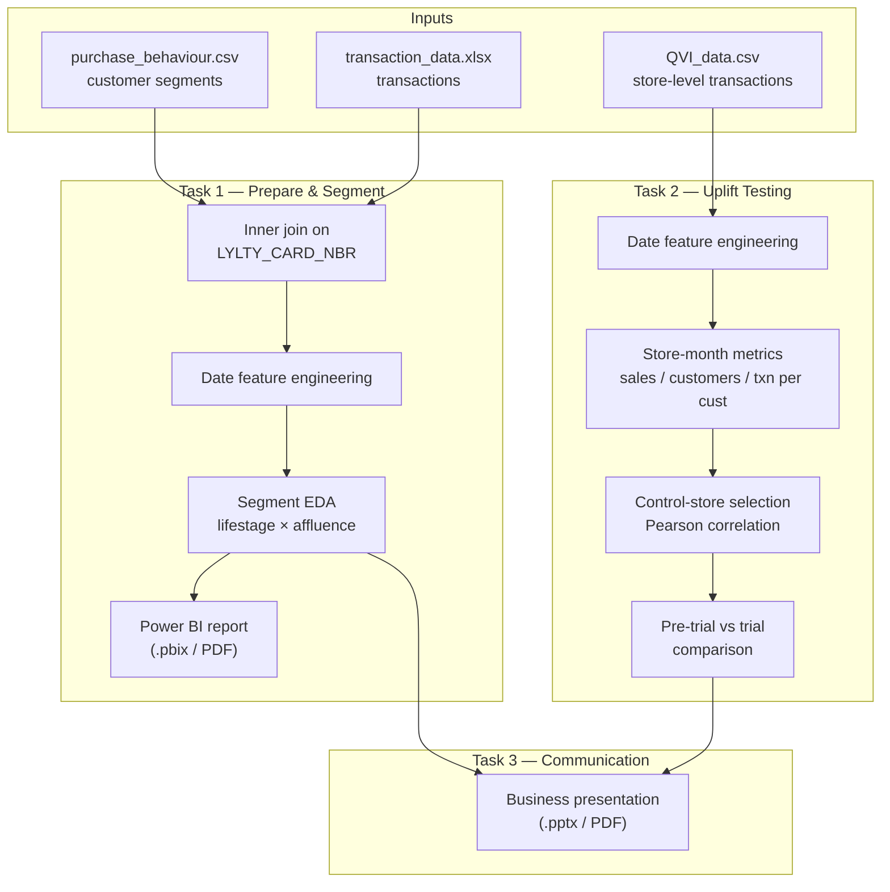

# Quantium Data Analytics — Chips Category & Store Trial Analysis


A portfolio implementation of the **Quantium Data Analytics virtual job simulation**, covering the
end-to-end analytics workflow for a retail chips category: transactional data preparation, customer
segmentation, and a store-level uplift test. The repository contains two Jupyter notebooks that
document the analysis end to end, a Power BI report, and a business-audience presentation.

---

## Table of Contents

- [Overview](#overview)
- [What This Repository Contains](#what-this-repository-contains)
- [Methodology](#methodology)
  - [Task 1 — Data Preparation & Customer Analytics](#task-1--data-preparation--customer-analytics)
  - [Task 2 — Experimenting & Uplift Testing](#task-2--experimenting--uplift-testing)
  - [Task 3 — Analytics & Commercial Application](#task-3--analytics--commercial-application)
- [System Architecture](#system-architecture)
- [Repository Structure](#repository-structure)
- [Datasets](#datasets)
- [Technology Stack](#technology-stack)
- [Installation](#installation)
- [Usage](#usage)
- [Evaluation & Recorded Results](#evaluation--recorded-results)
- [Reproducibility](#reproducibility)
- [Limitations & Future Improvements](#limitations--future-improvements)
- [Contributing](#contributing)
- [License & Acknowledgements](#license--acknowledgements)

---

## Overview

A supermarket chain wants to review the performance of its **chips category** and understand which
customer segments drive sales. The business has also run a **store trial** (a change to the store
layout in a small number of stores) and needs to know whether the trial increased sales.

This project answers those questions with a standard retail-analytics pipeline:

1. **Data preparation** — examine and clean the transaction and customer datasets, merge them, and
   engineer date-based features ready for analysis.
2. **Customer analytics** — quantify sales by customer segment (lifestage × affluence), identify the
   segments driving category performance, and report insights.
3. **Uplift testing** — select comparable control stores for each trial store, compare
   their performance before and during the trial, and recommend whether the trial should be rolled
   out.
4. **Commercial communication** — present the findings to a business audience in an accessible format.

**Intended audience:** data analysts, retail/merchandising analysts, and reviewers assessing a
portfolio of applied analytics work. The notebooks are also a useful worked example of retail data
cleaning, segment-level aggregation, and control-store selection.

**Nature of the project:** this is an **analysis and reporting** project. It is not a production
system, and it does not train or deploy machine-learning models. The "uplift testing" here is a
descriptive control-store comparison (see [Limitations](#limitations--future-improvements)).

---

## What This Repository Contains

| Deliverable | File | Description |
| --- | --- | --- |
| Task 1 notebook | [`task1_ data_preparation_and_customer_analytics/…Task 1…ipynb`](task1_%20data_preparation_and_customer_analytics/Forage-Quantium-Data%20Analytics%20Job%20Sim%20Task%201%20-%20Data%20Preparation%20and%20Customer%20Analytics.ipynb) | Data preparation, merge, feature engineering, and customer-segment EDA. |
| Task 1 report | `task1_ data_preparation_and_customer_analytics/Forage-Quantium-Data-Analytics-Job-Sim-Task-1-Data-Preparation-and-Customer-Analytics.pdf` | PDF export of the Task 1 notebook. |
| Task 1 dashboard | `task1_ data_preparation_and_customer_analytics/Forage-Quantium-Data-Analytics-Task-1-Customer-Analytics.pbix` (+ `.pdf`) | Power BI customer-analytics report and its PDF export. |
| Task 2 notebook | [`task2-experimenting-and-uplift-testing/…Task 2…ipynb`](task2-experimenting-and-uplift-testing/Forage-Quantium-Data-Analytics-Job-Sim-Task-2-Experimenting-and-Uplift-Testing.ipynb) | Store-trial control selection and uplift assessment. |
| Task 3 presentation | `task3-analytics-and-commercial-application/task3-presentation-analytics-and-commercial-application.pptx` (+ `.pdf`) | Non-technical business presentation of the findings. |
| Task briefs | `*/summary.txt` | The original task instructions for each of the three tasks. |
| Certificate | `coc/certificate_of_completion.pdf` | Certificate of completion for the job simulation. |

> The Power BI `.pbix` file requires **Power BI Desktop** to open; the accompanying PDF is a static
> export for reviewers without Power BI.

---

## Methodology

### Task 1 — Data Preparation & Customer Analytics

**Objective:** prepare a clean, analysis-ready dataset and identify the customer segments that drive
chips-category sales.

**Steps implemented in the notebook:**

1. **Load data** with pandas — `QVI_purchase_behaviour.csv` and `QVI_transaction_data.xlsx`.
2. **Data-quality inspection** using `DataFrame.info()`. Both inputs are reported as having no null
   values in the committed outputs.
3. **Explore the purchase-behaviour data** — frequency counts of `LIFESTAGE` (7 segments) and
   `PREMIUM_CUSTOMER` (Budget / Mainstream / Premium), visualised as bar and pie charts.
4. **Explore the transaction data** — `describe()` summary statistics and a head of the table.
   The summary surfaces two notable extreme values (`PROD_QTY` max = 200, `TOT_SALES` max = 650)
   relative to the interquartile range; the committed notebook flags anomalies in the task brief but
   does not filter these rows (see [Limitations](#limitations--future-improvements)).
5. **Merge** transaction and customer tables with an inner join on `LYLTY_CARD_NBR`.
6. **Feature engineering** — convert the Excel serial `DATE` to a real datetime
   (`pd.to_datetime(..., origin='1900-01-01', unit='D')`) and derive `Year`, `Month_Name`,
   `Month_Year`, `Week_Number`, `Quarter`, `Quarter_Year`, and `Weekday`.
7. **Persist** the merged dataset to `Merged_data.csv` (written at notebook runtime; not committed).
8. **EDA** — segment distributions, top-20 products, `PROD_QTY` distribution, temporal sales counts
   (by year, month, quarter, week, weekday), and a correlation heatmap.
9. **Report** — the Power BI `.pbix` report and its PDF export.

**Key metrics defined:** total sales (`TOT_SALES`) and counts of transactions, analysed by
`LIFESTAGE`, `PREMIUM_CUSTOMER`, product, store, and time period.

### Task 2 — Experimenting & Uplift Testing

**Objective:** determine whether the store trial increased sales, using comparable control stores.

**Trial setup (as encoded in the notebook):**

- **Trial stores:** 77, 86, 88.
- **Pre-trial period:** before February 2019.
- **Trial period:** February 2019 onward.
- **Control-store candidates:** all other stores with complete records.

**Method implemented:**

1. **Parse and enrich** `QVI_data.csv`, converting `DATE` to datetime and deriving calendar features.
2. **Build store-month metrics** by grouping on `STORE_NBR` × `Month_Year`:
   - `TOT_SALES` — monthly total sales,
   - `TOT_CUST` — monthly count of unique customers (`LYLTY_CARD_NBR`),
   - `TXN_PER_CUST` — unique transactions (`TXN_ID`) per unique customer.
3. **Remove incomplete stores** — stores with missing months (identified via a pivot table and
   `isnull()` checks) are dropped.
4. **Control-store selection** — for each trial store, compute the Pearson correlation between the
   store's pre-trial metric vector and every candidate store's, take the five highest-correlating
   candidates, and rank them by their difference from the trial store. The notebook settles on:
   - Store **77** → control **46**
   - Store **86** → control **57**
   - Store **88** → control **165**
5. **Visual comparison** — grouped bar charts of total sales, total customers, and transactions per
   customer for each trial/control pair, for both the pre-trial and trial windows.
6. **Conclusion** — summarise which store performed best and identify the driver of any change.

### Task 3 — Analytics & Commercial Application

**Objective:** translate the analysis into a clear, non-technical business presentation.

The deliverable is a slide deck (`.pptx`, with a PDF export) that communicates the problem statement,
context, findings, and recommended next steps for a business audience. `summary.txt` records the
intended presentation criteria: audience data-literacy level, agenda, problem statement, overview and
context, content balance, layout, and a summary/next-steps section.

---

## System Architecture

The project is a two-stage analytics pipeline: raw retail data is cleaned and enriched, then either
analysed descriptively (Task 1) or used for control-store uplift comparison (Task 2), before the
findings are packaged for a business audience (Task 3).



---

## Repository Structure

```text
quantium-data-analytics/
├── README.md
├── LICENSE                        # MIT License
├── CONTRIBUTING.md                # Contribution guidance
├── CODE_OF_CONDUCT.md             # Community code of conduct
├── assets/
│   └── header_banner.png          # Banner used in this README
├── coc/
│   └── certificate_of_completion.pdf
├── task1_ data_preparation_and_customer_analytics/
│   ├── Forage-Quantium-Data Analytics Job Sim Task 1 - Data Preparation and Customer Analytics.ipynb
│   ├── Forage-Quantium-Data-Analytics-Job-Sim-Task-1-Data-Preparation-and-Customer-Analytics.pdf
│   ├── Forage-Quantium-Data-Analytics-Task-1-Customer-Analytics.pbix
│   ├── Forage-Quantium-Data-Analytics-Task-1-Customer-Analytics.pdf
│   └── summary.txt
├── task2-experimenting-and-uplift-testing/
│   ├── Forage-Quantium-Data-Analytics-Job-Sim-Task-2-Experimenting-and-Uplift-Testing.ipynb
│   └── summary.txt
└── task3-analytics-and-commercial-application/
    ├── task3-presentation-analytics-and-commercial-application.pptx
    ├── task3-presentation-analytics-and-commercial-application.pdf
    └── summary.txt
```

> Note the space in the `task1_ data_preparation_and_customer_analytics/` directory name —
> commands referencing it must be quoted.

**Important:** The input datasets are **not included** in this repository (see
[Datasets](#datasets)). The notebooks expect the data files to sit alongside them in their respective
task folders.

---

## Datasets

The datasets are provided as part of the Quantium Data Analytics job simulation and are **not
committed** to this repository. To run the notebooks you must supply the files listed below.

**Task 1 inputs**

| File | Rows | Columns | Fields |
| --- | --- | --- | --- |
| `QVI_purchase_behaviour.csv` | 72,637 | 3 | `LYLTY_CARD_NBR`, `LIFESTAGE`, `PREMIUM_CUSTOMER` |
| `QVI_transaction_data.xlsx` | 264,836 | 8 | `DATE` (Excel serial), `STORE_NBR`, `LYLTY_CARD_NBR`, `TXN_ID`, `PROD_NBR`, `PROD_NAME`, `PROD_QTY`, `TOT_SALES` |

**Task 2 input**

| File | Rows | Columns | Fields |
| --- | --- | --- | --- |
| `QVI_data.csv` | 264,834 | 12 | `LYLTY_CARD_NBR`, `DATE`, `STORE_NBR`, `TXN_ID`, `PROD_NBR`, `PROD_NAME`, `PROD_QTY`, `TOT_SALES`, `PACK_SIZE`, `BRAND`, `LIFESTAGE`, `PREMIUM_CUSTOMER` |

Row counts and columns above are taken from the `DataFrame.info()`/`describe()` outputs stored in the
committed notebooks. The `DATE` field in the Task 1 transaction file is an Excel serial number in the
range 43,282–43,646, corresponding to approximately **1 July 2018 – 30 June 2019**.

---

## Technology Stack

| Category | Tools | Role |
| --- | --- | --- |
| Language | Python 3.9 | Analysis and feature engineering. |
| Notebooks | Jupyter (`ipykernel`) | Executable analysis documents. |
| Data processing | pandas, NumPy | Loading, merging, grouping, aggregation, date handling. |
| Visualisation | Matplotlib, Seaborn, Plotly (`graph_objects`, `express`), IPython.display | Static and interactive charts. |
| Business intelligence | Microsoft Power BI | Interactive customer-analytics report (`.pbix`). |
| Presentation | Microsoft PowerPoint | Business-facing slide deck (`.pptx`). |

There is **no `requirements.txt` or environment file** in the repository; the dependency set is
implied by the notebook imports (see [Installation](#installation)).

---

## Installation

### Prerequisites

- Python **3.9** (the version recorded in the notebook metadata).
- `pip`.
- **Power BI Desktop** (optional) to open the `.pbix` report.
- Microsoft PowerPoint or a compatible viewer (optional) for the `.pptx`.

### Steps

```bash
# 1. Clone the repository
git clone https://github.com/charlesakinnurun/quantium-data-analytics.git
cd quantium-data-analytics

# 2. Create and activate a virtual environment
python -m venv .venv

# Windows (PowerShell)
.venv\Scripts\Activate.ps1

# macOS / Linux
source .venv/bin/activate

# 3. Install the dependencies used by the notebooks
pip install pandas numpy matplotlib seaborn plotly jupyter openpyxl
```

`openpyxl` is required to read the `.xlsx` transaction file in Task 1.

### Data setup

Place the input files next to the notebooks that use them:

```text
task1_ data_preparation_and_customer_analytics/
├── QVI_purchase_behaviour.csv
├── QVI_transaction_data.xlsx
└── ...notebook

task2-experimenting-and-uplift-testing/
├── QVI_data.csv
└── ...notebook
```

The notebooks read these files by relative filename, so **the working directory must be the notebook's
own folder** (the Jupyter default when you open the notebook from that directory).

---

## Usage

### Run a notebook

Start Jupyter from the repository root and open a notebook:

```bash
jupyter notebook
```

Then open, for example:

- `task1_ data_preparation_and_customer_analytics/Forage-Quantium-Data Analytics Job Sim Task 1 - Data Preparation and Customer Analytics.ipynb`
- `task2-experimenting-and-uplift-testing/Forage-Quantium-Data-Analytics-Job-Sim-Task-2-Experimenting-and-Uplift-Testing.ipynb`

Run all cells (`Cell → Run All`). Each notebook performs its analysis in sequence and writes its
intermediate outputs to the working directory:

| Notebook | Writes |
| --- | --- |
| Task 1 | `Merged_data.csv` |
| Task 2 | `updated_data.csv`, `updated_data.xlsx` |

These generated files are not committed to the repository.

### Open the Power BI report

Open `task1_ data_preparation_and_customer_analytics/Forage-Quantium-Data-Analytics-Task-1-Customer-Analytics.pbix`
in Power BI Desktop. If Power BI is unavailable, use the exported PDF alongside it.

### View the presentation

Open the Task 3 deck in PowerPoint, or read the PDF export:
`task3-analytics-and-commercial-application/task3-presentation-analytics-and-commercial-application.pdf`.

> This project has no CLI, API, or web service. Interaction is through the notebooks, Power BI,
> and the presentation.

---

## Evaluation & Recorded Results

There is no automated test suite or benchmark in this repository. The results below are the values
**stored in the committed notebook outputs** and are reproduced when the notebooks are re-run against
the original datasets. They are descriptive statistics, not model performance metrics.

### Task 1 — segment sizes (as recorded)

Customer segments in the merged dataset (`LIFESTAGE`), largest first:

| Lifestage | Transactions |
| --- | ---: |
| Older Singles/Couples | 54,479 |
| Retirees | 49,763 |
| Older Families | 48,596 |
| Young Families | 43,592 |
| Young Singles/Couples | 36,377 |
| Midage Singles/Couples | 25,110 |
| New Families | 6,919 |
| **Total** | **264,836** |

Affluence split (`PREMIUM_CUSTOMER`): Mainstream 101,988 · Budget 93,157 · Premium 69,691.

The merged dataset spans calendar years 2018 (132,236 transactions) and 2019 (132,600).

### Task 2 — pre-trial store metrics (as recorded)

Aggregated pre-trial totals per store:

| Store | Role | Total sales | Total customers | Transactions per customer |
| --- | --- | ---: | ---: | ---: |
| 77 | Trial | 1,699.00 | 299 | 7.405 |
| 86 | Trial | 6,119.85 | 697 | 8.799 |
| 88 | Trial | 9,383.60 | 880 | 8.524 |
| 46 | Control (for 77) | — | — | — |
| 57 | Control (for 86) | — | — | — |
| 165 | Control (for 88) | — | — | — |

**Recorded conclusion (from the notebook's markdown):** Store **88** slightly outperformed its control
store (**165**) across the compared attributes and was the strongest implementation of the trial. The
apparent driver of higher total sales was an increase in the **number of purchasing customers** rather
than an increase in **transactions per customer**.

The specific control-store figures for stores 46, 57, and 165 are not summarised in the notebook's
stored output and are therefore omitted here rather than estimated. Re-run the notebooks to
regenerate the full tables.

---

## Reproducibility

- **Determinism:** the analysis is deterministic — it uses filtering, joins, grouping, aggregation,
  and Pearson correlation only. There is no model training, so there are **no random seeds** to set.
  The only stochastic dependency is Plotly's rendering, which does not affect the computed values.
- **Dependency versions:** the notebooks were authored under Python 3.9 with the libraries listed in
  [Installation](#installation). No pinned versions are committed, so exact reproducibility of chart
  styling may vary with library versions.
- **Data availability:** the input datasets are not included. Results can only be reproduced with the
  original simulation data files placed as described in [Data setup](#data-setup).
- **Working directory:** notebooks must be run from their own folders so the relative data paths
  resolve.

---

## Limitations & Future Improvements

**Current limitations (from the implementation):**

- **Datasets are not included.** The notebooks cannot run as-is from a fresh clone; the Quantium
  simulation data must be supplied.
- **Outliers are inspected but not treated.** Task 1's `describe()` output shows a maximum
  `PROD_QTY` of 200 and `TOT_SALES` of 650, far outside the interquartile range, but the committed
  notebook does not remove or cap them, so they remain in the merged dataset and the segment totals.
- **Uplift testing is descriptive, not inferential.** Task 2 compares trial stores against
  correlation-selected control stores using aggregate sales, customers, and transactions per customer.
  It does **not** run a hypothesis test, compute a confidence interval, or fit a formal uplift model,
  so "significant difference" in the narrative is not backed by a statistical test.
- **Control-store selection heuristic.** Candidates are ranked by Pearson correlation across the
  pre-trial metric vector, and the `DIFFERENCE` column mixes a within-candidate subtraction with a
  mean-centred value; the logic is heuristic and its intermediate values include negatives that are
  hard to interpret, so the selected controls should be treated as reasonable rather than optimal.
- **No environment/dependency pinning.** There is no `requirements.txt`, `environment.yml`, or lock
  file.
- **No automated tests or linting.** Correctness is established only by the stored notebook outputs.
- **Leftover scaffolding.** The Task 1 notebook ends with a reference to an external GitHub-hosted
  Power BI PDF, and both notebooks retain the task-scaffold structure; these are artefacts of the job
  simulation rather than project code.

**Proposed improvements (not implemented):**

- Add a `requirements.txt` and a short data-acquisition note to make the project runnable from a clean
  clone.
- Add explicit outlier handling for `PROD_QTY`/`TOT_SALES` and document the chosen thresholds.
- Replace the heuristic control comparison with a proper pre/post test (e.g. difference-in-differences)
  and report effect sizes with confidence intervals.
- Extract the store-metric and control-selection logic into a reusable, testable module with unit
  tests.
- Export a small, shareable sample dataset (or synthetic equivalent) so reviewers can execute the
  notebooks without the proprietary simulation data.

---

## Contributing

Contributions are welcome. See [CONTRIBUTING.md](CONTRIBUTING.md) for the project's guidance: open an
Issue or Pull Request for improvements such as new analysis techniques, additional feature
engineering, or documentation, and accompany changes with clear documentation and updated results.
Please also review [CODE_OF_CONDUCT.md](CODE_OF_CONDUCT.md).

---

## License & Acknowledgements

**License:** released under the [MIT License](LICENSE), © 2025 Charles Akinnurun.

**Acknowledgements:**

- The problem statement, datasets, and task structure come from the **Quantium Data Analytics Job
  Simulation** hosted on **Forage**. This repository is an independent implementation for portfolio
  and educational purposes and is not affiliated with or endorsed by Quantium or Forage.
- Built with open-source tools including [pandas](https://pandas.pydata.org/),
  [NumPy](https://numpy.org/), [Matplotlib](https://matplotlib.org/),
  [Seaborn](https://seaborn.pydata.org/), and [Plotly](https://plotly.com/python/).
- Reporting and presentation were produced with **Microsoft Power BI** and **Microsoft PowerPoint**.
